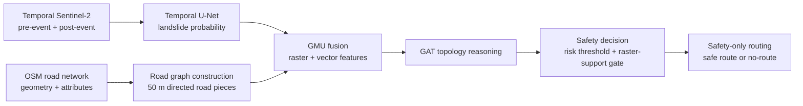

# Structure-Aware Raster-Vector Fusion for Post-Landslide Road Assessment & Safety Routing

A research prototype for assessing likely post-landslide road exposure and producing safety-only routes. The system combines temporal Sentinel-2 landslide evidence with an OpenStreetMap-derived road graph. Raster and vector evidence are fused at the road-segment level, then topology is used to identify segments that should be excluded from routing.

> **Research use only.** This project identifies modelled landslide exposure, not verified road closures or passability. Outputs require expert review before operational use.

## What the system does



The decision process has six stages:

1. **Raster representation** - A temporal U-Net processes pre-event and post-event Sentinel-2 imagery.
2. **Vector representation** - OSM roads are noded and split into directed 50 m road pieces.
3. **Multimodal fusion** - A gated multimodal unit (GMU) combines raster and vector features.
4. **Graph reasoning** - A graph-attention network (GAT) exchanges context among connected road pieces.
5. **Safety decision** - A road piece is marked dangerous only when its GMU-GAT risk meets the learned threshold **and** it is within raster-supported hazard evidence.
6. **Safety routing** - Danger edges are excluded before a shortest safe path is returned.

## Key design choices

- **Temporal imagery:** Uses four Sentinel-2 bands (B02, B03, B04, B08) before and after an event, plus change features, for a 12-channel U-Net input.
- **Road-level analysis:** Raster probabilities are sampled along each road piece instead of treating a road as a single point or a pixel.
- **Topology-aware fusion:** Road connectivity is represented with a line graph, enabling the GAT to reason over neighbouring road pieces.
- **Conservative safety gate:** The learned road-risk score is not sufficient by itself. A predicted danger segment must also intersect a 500 m buffer around landslide probability pixels at or above 0.81.
- **Explicit no-route outcome:** If exclusions disconnect the requested origin and destination, the system returns no safe route rather than relaxing the safety policy.

## Repository layout

```text
.
├── app/
│   └── drcarys-v3/
│       ├── dist/                         # Static dashboard, map layers, demo assets
│       └── runtime/                      # Local upload/session outputs
├── code/
│   ├── drcarys_v3_server.py              # Flask inference API and routing workflow
│   ├── build_weak_road_edge_dataset.py   # Weak-label and road-feature builder
│   ├── train_weak_gmu_gat.py             # GMU-GAT trainer
│   ├── fuse_landslide_road_confidence.py # Temporal raster inference utilities
│   └── roadseg/                          # Segmentation models, training, evaluation
├── results/
│   ├── sen12_temporal_chimanimani_finetuned/
│   ├── weak_gmu_gat_chimanimani/
│   └── chimanimani_study_graph_v2_local_buffer_update/
├── dataset/                              # Local only; ignored by Git
└── README.md
```

## Quick start

### Prerequisites

- Python 3.11+
- PyTorch (CPU is supported; CUDA is optional)
- GDAL-compatible Python environment for GeoPandas and Rasterio

Create a virtual environment and install the runtime dependencies:

```powershell
python -m venv .venv
.\.venv\Scripts\Activate.ps1
python -m pip install --upgrade pip
python -m pip install flask torch numpy geopandas rasterio shapely pyproj xarray netcdf4 pillow
```

Start the local server from the repository root:

```powershell
python code/drcarys_v3_server.py
```

Open [http://127.0.0.1:8766](http://127.0.0.1:8766).

The dashboard supports the included demonstration scenes and accepts either:

- a single-band landslide-probability GeoTIFF (`.tif` or `.tiff`) with values in `[0, 1]`; or
- a supported temporal Sentinel-2 NetCDF scene (`.nc`) containing pre-event and post-event acquisitions.

For GeoTIFF uploads, the file must use the same projected CRS as the supplied study road graph. The API rejects unprojected rasters and values outside the expected probability range.

## Inputs and outputs

| Component | Input | Output |
| --- | --- | --- |
| Temporal U-Net | Sentinel-2 temporal NetCDF | Landslide probability raster |
| Raster ingestion | Probability GeoTIFF | Thresholded hazard polygons |
| Road graph | OSM-derived roads and attributes | Noded, directed 50 m road pieces |
| GMU-GAT | Raster statistics + road features + topology | Weak road-exposure risk per road piece |
| Safety routing | Risk scores, raster support, origin/destination | Safe route or explicit no-route result |

The project stores inspectable outputs in `results/`, including GeoJSON road layers, a GraphML road graph, hazard-buffer layers, model checkpoints, validation reports, and routing-evaluation artifacts.

## Models and feature design

### Temporal landslide model

The temporal segmentation stage uses a U-Net implemented in PyTorch. For each scene, it uses B02, B03, B04, and B08 from selected pre-event and post-event acquisitions, as well as band-wise reflectance differences. The model generates a probability raster, with a selected operational threshold of **0.81**.

### Road-exposure model

Each physical road piece receives:

- **Raster features:** mean probability, maximum probability, 95th-percentile probability, and fraction of samples at or above 0.81.
- **Vector features:** log road length, normalised speed, endpoint degrees, and road-class information.
- **Topology:** line-graph adjacency based on shared road endpoints.

The GMU produces a fused embedding from raster and vector features. Two custom GAT layers then produce a weak road-exposure score. The selected validation threshold is **0.46**.

## Reproducing the weak-supervision workflow

Raw datasets are intentionally excluded from the repository. Place local data under `dataset/` using the paths expected by the scripts, or pass explicit paths through their CLI options.

```powershell
# Build 50 m road pieces, raster/vector features, and weak exposure labels.
python code/build_weak_road_edge_dataset.py `
  --s2 dataset/Sen12Landslides_S2_14GB/s2 `
  --manifests dataset/Sen12Landslides_S2_14GB/temporal_cache_chimanimani `
  --probability-root results/chimanimani_full_post_event_coverage `
  --out dataset/weak_road_edge_chimanimani

# Train and select the GMU-GAT checkpoint by internal-validation IoU.
python code/train_weak_gmu_gat.py `
  --data dataset/weak_road_edge_chimanimani `
  --out results/weak_gmu_gat_chimanimani
```

`weak_exposed` labels indicate that a 50 m road piece intersects a 500 m buffer around a **ground-truth landslide mask**. They measure exposure supervision, not observed road damage, closure, or passability.

## Evaluation snapshot

### Temporal U-Net held-out Chimanimani test

| Patches | Threshold | Precision | Recall | F1 | IoU | Accuracy |
| ---: | ---: | ---: | ---: | ---: | ---: | ---: |
| 30 | 0.81 | 0.448 | 0.396 | 0.421 | 0.266 | 0.989 |

### Weak road-exposure validation

| Method | Road pieces | Threshold | Precision | Recall | F1 | IoU |
| --- | ---: | ---: | ---: | ---: | ---: | ---: |
| Raster-buffer rule | 187 | 0.50 | 0.613 | 0.200 | 0.302 | 0.178 |
| GMU-GAT fusion | 187 | 0.46 | 0.638 | 0.947 | 0.763 | 0.616 |

The GMU-GAT metrics are evaluated against weak exposure labels. The held-out weak road-exposure split contains no positive samples, so held-out recall, F1, and IoU for the graph model are not claimed.

### Routing behaviour check

For 50 origin-destination pairs, 42 baseline routes used at least one danger edge. After safety exclusions, 10 safe routes remained available and 40 pairs correctly returned no safe route. No returned safe route used a marked danger edge. Where both routes existed, the mean detour was 1,224 m and the maximum detour was 9,963 m.

## Limitations and responsible use

- Landslide probabilities are not direct observations of road condition.
- The road model is trained using a spatial exposure proxy, not independently labelled road closures.
- Road geometry and attributes can be incomplete or outdated after an event.
- Sentinel-2 resolution can mix roads, vegetation, bare ground, cloud shadow, and landslide pixels.
- The 500 m buffer is a conservative modelling choice, not a universal damage radius.

